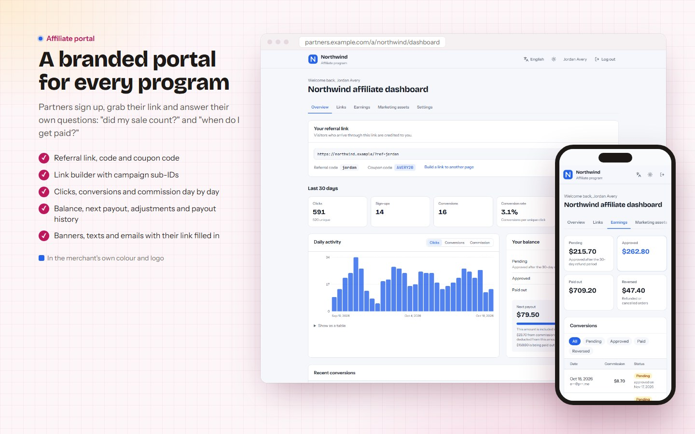
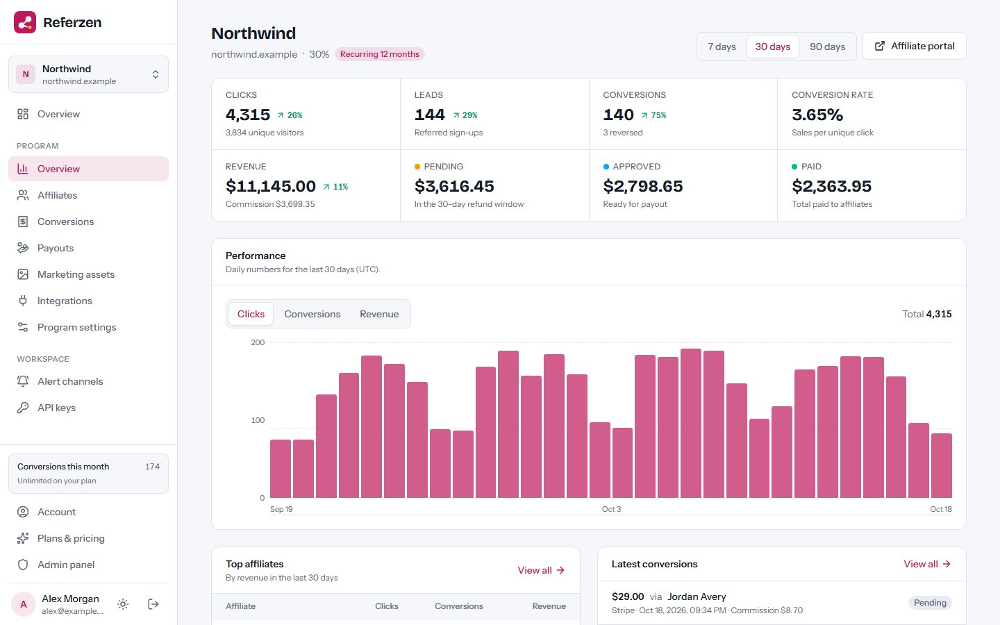
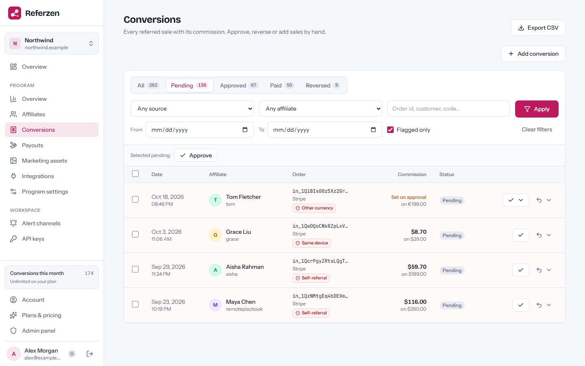
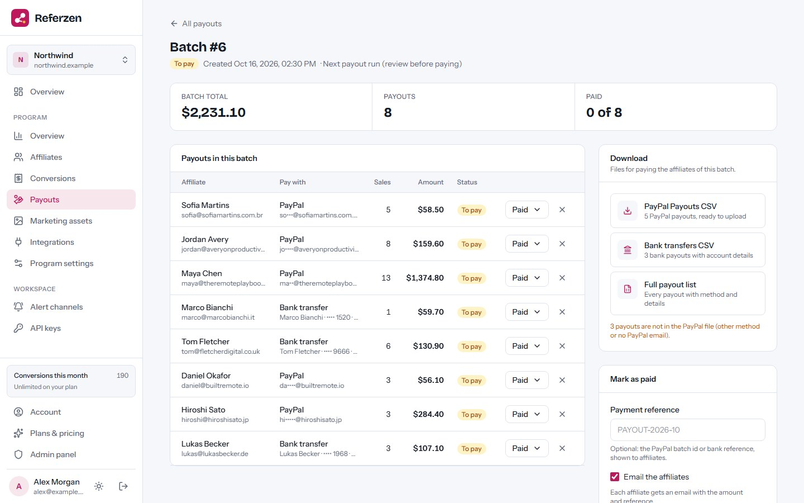
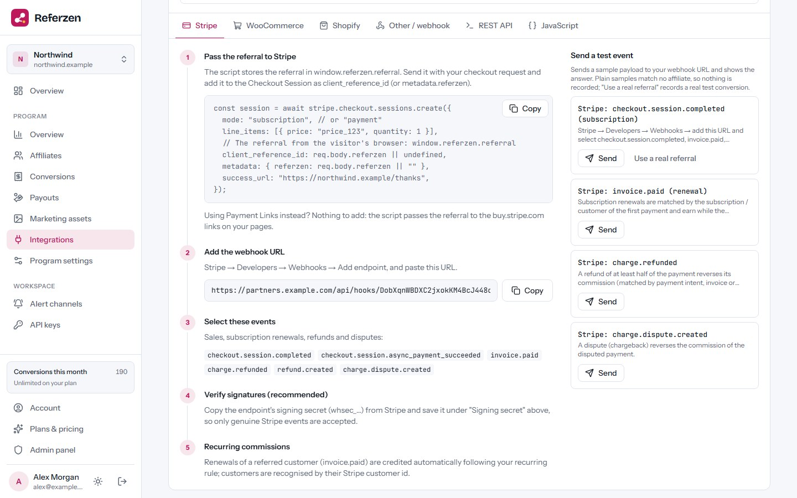
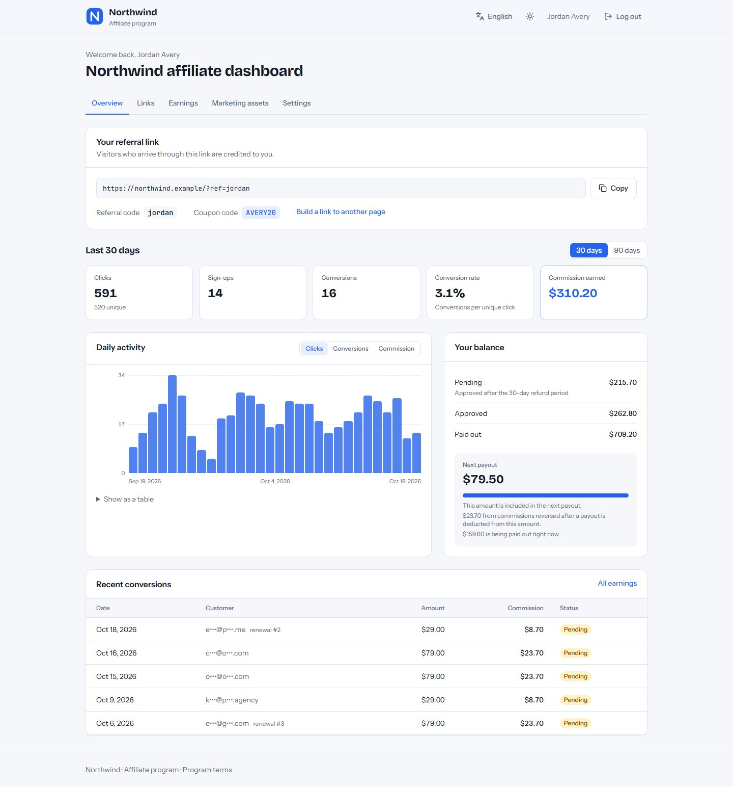
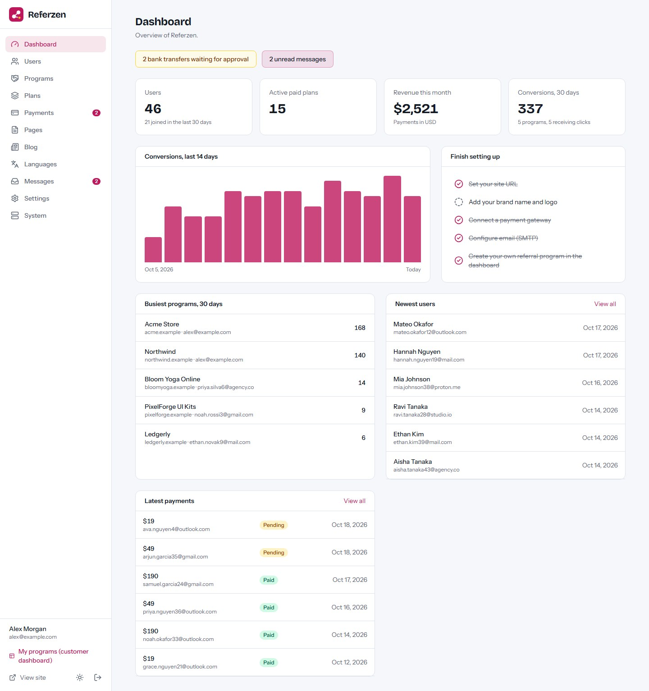

# Referzen

**Open-source affiliate and referral program software — as a self-hosted SaaS.** Merchants create
referral programs for their SaaS product or online store, affiliates get a branded portal, and
sales are tracked from Stripe, WooCommerce, Shopify, a generic webhook or the REST API. Built with
Next.js 16, React 19 and Tailwind CSS 4. Runs on a VPS, Docker, cPanel (Node.js) or Vercel, with
MySQL/MariaDB or a zero-setup SQLite database.

**Live demo:** https://referzen-demo.vercel.app — merchant/admin login `demo@referzen.app` /
`demo12345`; affiliate portal https://referzen-demo.vercel.app/a/northwind with
`partner@referzen.app` / `demo12345` (data resets regularly).



## Features

- **Referral programs:** percentage or fixed commissions, recurring for N months or for life,
  per-affiliate rates, cookie window, hold period (refund window), minimum payout, payout methods
  and terms. Commissions are single-tier: an affiliate earns on the customers they referred.
- **Tiny tracking script:** `rz.js` (about 1.4 KB gzipped) keeps the referral in a first-party
  cookie and hands it to the checkout; JavaScript API for leads and browser conversions.
- **Integrations:** Stripe (Checkout, Payment Links, subscription renewals, refunds, disputes),
  WooCommerce and Shopify order webhooks, a generic JSON webhook and a REST API, with signature
  verification and affiliate coupon codes.
- **Branded affiliate portal** (`/a/<program>`): sign-up, link builder, stats, earnings,
  payouts, marketing assets (links, banners, texts, email templates) and payout details.
- **Fraud checks:** bot and duplicate-click filtering, self-referral, same-device,
  repeat-customer and other-currency flags that wait for review.
- **Payouts:** due balances, payout batches, PayPal Payouts CSV and bank transfer CSV, payment
  references, refunds after a payout deducted from the next one. Referzen never moves money itself.
- **Notifications:** email, Slack, Discord, Microsoft Teams, Telegram and signed webhooks, a daily
  merchant digest and a weekly affiliate summary.
- **Privacy-friendly:** no IP addresses stored for clicks, only a daily-salted anonymous hash.
- **SaaS ready:** merchant accounts, plans with program/affiliate/conversion/API limits, Stripe /
  PayPal / Razorpay / bank transfer payments, a blog and a full admin panel.
- **Multi-language** with right-to-left support (Arabic and Hindi packs included).
- **Web installer** — no command line needed on shared hosting.

| Program overview | Conversions & fraud flags | Payout batch |
| --- | --- | --- |
|  |  |  |
| **Stripe integration** | **Portal dashboard** | **Admin panel** |
|  |  |  |

More screenshots are in [`marketing/final/screenshots`](marketing/final/screenshots).

## Hosted version & paid installation

Need Referzen hosted for you, installed on your own server, or customised? Contact
**[EpiFive](https://www.epifive.com/services)**.

More open-source projects: https://www.epifive.com/open-source

## Quick start

```bash
git clone https://github.com/epifive/referzen.git
cd referzen/app
npm install
npm run dev
```

Open http://localhost:3000 — you are redirected to the web installer at `/install`. Choose
**SQLite** for a zero-setup local database, or **MySQL/MariaDB** for production.

Production, Docker, PM2, cPanel and Vercel setups, background jobs (lazy mode, cron URL or
worker), every integration and every setting are covered in [`app/README.md`](app/README.md) and
the full guide in [`documentation/index.html`](documentation/index.html) (open it in a browser).

**Requirements:** Node.js 20.9+ (22.13+ for SQLite), MySQL 5.7+ / MariaDB 10.3+ or SQLite, HTTPS
in production (merchant websites load the tracking script and payment providers send webhooks only
to `https://` addresses), and a way to run background jobs (cron URL, worker or lazy mode).

## Repository layout

| Path | What |
| --- | --- |
| `app/` | The Next.js application (dashboard, affiliate portal, tracker, webhooks, admin, installer, worker) |
| `documentation/` | Full user and admin guide (single HTML file) |
| `marketing/` | Screenshot and preview scripts and the final screenshots |

## Contributing

Bug reports and pull requests are welcome — please open an
[issue](https://github.com/epifive/referzen/issues) first for larger changes. Run
`npm run typecheck`, `npm run lint` and `npm run build` in `app/` before sending a PR.

## License

[MIT](LICENSE) © 2026 EpiFive
